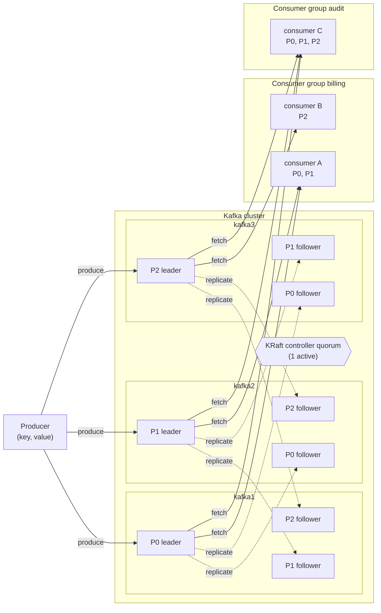

# 01 — Hello Kafka (Book chapters 1 & 2)

> Goal: produce and consume your first messages, and learn the vocabulary every later folder uses:
> **broker, topic, partition, offset, leader, replica, ISR, producer, consumer, consumer group, commit log, controller (KRaft)**.

## Prerequisites

```bash
make up            # from the repo root: 3 brokers + Kafka UI + Prometheus + Grafana
source .venv/bin/activate   # created by `make venv`
```

## The mental model (chapter 2.3)

```
                         ┌──────────────── Kafka cluster ────────────────┐
 Producer ──produce──▶   │ kafka1        kafka2        kafka3            │  ──fetch──▶ Consumer group "billing"
  (key, value)           │ P0 (leader)   P0 (follower) P0 (follower)     │              ├─ consumer A  ← P0, P1
                         │ P1 (follower) P1 (leader)   P1 (follower)     │              └─ consumer B  ← P2
                         │ P2 (follower) P2 (follower) P2 (leader)       │
                         │      ▲ KRaft controller quorum (1 active)     │  ──fetch──▶ Consumer group "audit"
                         └───────────────────────────────────────────────┘              └─ consumer C  ← P0, P1, P2
```

<!-- mermaid: Kafka cluster -->


| Term | What it really is |
|------|-------------------|
| **Topic** | A named *category* of records — logically one stream, physically split into partitions. |
| **Partition** | An **append-only, ordered, immutable log** (a directory of segment files on disk). Unit of parallelism & ordering. |
| **Offset** | Position of a record inside *one* partition (0,1,2,…). Never reused. |
| **Broker** | A Kafka server process. Hosts partition replicas, serves reads/writes. |
| **Leader / follower** | Each partition has one leader replica (all reads & writes go here) and followers that copy it. |
| **ISR** | In-Sync Replicas: followers that are caught up. Only ISR members can become leader (safely). |
| **Controller** | Brain of the cluster: elects partition leaders, tracks broker liveness. With **KRaft** (this lab) it's a Raft quorum *inside* Kafka; older clusters used **ZooKeeper** (book ch. 2.3.3 / 6.2). |
| **Consumer group** | Consumers sharing a `group.id` *split* the partitions between them. Different groups each get *all* data. |
| **Commit log** | Kafka doesn't delete a message when it's read. Data stays until *retention* removes it → many readers, replay. |

> **ZooKeeper vs KRaft:** the book (2022) describes ZooKeeper. Kafka 3.3+ runs without it (KRaft); Kafka 4.0 removed ZooKeeper entirely.
> Everything the book says ZooKeeper did (controller election, broker membership, topic metadata) now lives in the internal
> `__cluster_metadata` topic replicated by the controllers — we peek at it in `07-topics-partitions-internals`.

## Exercises

### 1. CLI first (exactly what the book does)
```bash
bash 01-hello-kafka/cli_walkthrough.sh
```
Look at the `--describe` output: the `Leader` of the 3 partitions is spread across brokers 1/2/3 — that's how Kafka spreads load.

### 2. Python producer
```bash
python 01-hello-kafka/hello_producer.py -n 12
python 01-hello-kafka/hello_producer.py -n 6 --key user-42     # all go to ONE partition
```
Observe: without a key, records are batched to one partition and then the *sticky partitioner* moves on;
with a key every record lands in the same partition (`murmur2(key) % numPartitions`).

### 3. Python consumer
```bash
python 01-hello-kafka/hello_consumer.py --group demo
python 01-hello-kafka/hello_consumer.py --group demo    # prints nothing: the group already committed its offsets
python 01-hello-kafka/hello_consumer.py                 # random new group => reads everything again
```
**Key insight**: reading does not delete. A new group can re-read the whole log. That's the "commit log" (ch. 2.3.5).

### 4. Look at it in the UI
* Kafka UI → http://localhost:8080 → Topics → `kinaction_helloworld` → *Messages* (see partition + offset columns) and *Consumers*.
* Grafana → http://localhost:3000 → "Kafka Labs — Cluster Overview" → *Messages in / sec*.

## Exactly-once / delivery semantics vocabulary (ch. 2.6.2)
* **At-most-once** – commit before processing → a crash loses messages.
* **At-least-once** – process, then commit → a crash re-delivers (duplicates). *Default for most apps.*
* **Exactly-once** – idempotent producer + transactions + `read_committed` consumers → see `13-transactions-exactly-once`.

## Where to next
`02-designing-events` (ch. 3) → `03-producers` (ch. 4).
