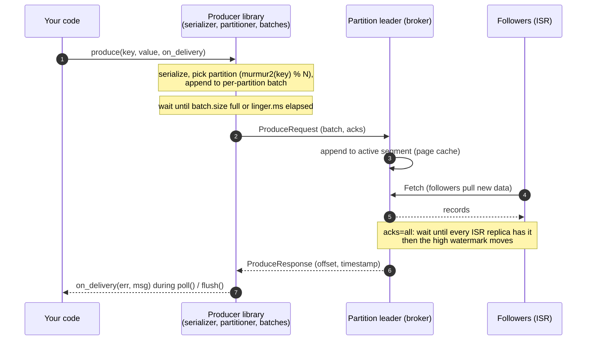

# 03 — Producers: sourcing data (Book chapter 4)

> Goal: understand what happens between `produce()` and "the data is safe", and which knobs trade **latency ↔ throughput ↔ durability**.

## How a produce request flows

```
your code ──produce(k,v)──▶ serializer ──▶ partitioner ──▶ per-partition batch (memory, batch.size / linger.ms)
                                                                │  background sender thread
                                                                ▼
                                             leader of partition N (broker)
                                              │ append to active segment (page cache)
                                              │ followers FETCH the new data
                                              │ wait for ISR (acks=all)  ──▶ high watermark moves
                                              ▼
                      on_delivery(err, msg) ◀── response (offset, timestamp)  — delivered via poll()/flush()
```

<!-- mermaid: your code ──produce -->


## Scripts (run from repo root, cluster up: `make up`)

| # | Script | Book § | What you learn |
|---|--------|--------|----------------|
| 1 | `01_producer_basics.py` | 4.1 | async + callbacks vs "sync" flush-per-message (100x+ difference) |
| 2 | `02_keys_and_partitioning.py` | 4.2 | key → partition with **murmur2**; librdkafka's default partitioner ≠ Java's (gotcha!) |
| 3 | `03_acks_durability_bench.py` | 4.2.2 | `acks=0/1/all` throughput and latency |
| 4 | `04_batching_compression_bench.py` | 4.2.2 | `linger.ms`, `batch.size`, gzip/snappy/lz4/zstd — bytes on the wire |
| 5 | `05_idempotence_and_ordering.py` | 4.2 | Producer ID + sequence numbers, read straight out of the log segment |
| 6 | `06_timestamps.py` | 4.2.3 | `CreateTime` vs `LogAppendTime` |
| 7 | `07_headers_and_explicit_partition.py` | 4.x | headers (tracing), choosing the partition yourself |
| 8 | `08_errors_and_retries.py` | 4.x | retriable vs fatal errors, batch-level size limit |

## Producer configs cheat sheet

| Config | Default (librdkafka / Java) | Meaning |
|---|---|---|
| `bootstrap.servers` | – | Any 1+ brokers; used only to discover the cluster (ch. 4.2.1) |
| `acks` | `all` (since Kafka 3.0) | 0 = don't wait, 1 = leader only, all = all ISR |
| `enable.idempotence` | `true` (Kafka 3.0+) | no duplicates on retry, ordering with ≤5 in-flight |
| `linger.ms` | 5 (librdkafka) / 0→5 (Java 3.x+4) | wait up to N ms to fill a batch |
| `batch.size` | 1 MB librdkafka / 16 KB Java | max bytes per partition batch |
| `compression.type` | none | gzip, snappy, lz4, zstd — applied per batch |
| `delivery.timeout.ms` | 120000 | total time to keep retrying a record |
| `max.in.flight.requests.per.connection` | 5 | >1 can reorder on retry **unless** idempotence is on |
| `partitioner` (librdkafka) | `consistent_random` | use `murmur2_random` to match Java |

## Guarantees in one picture
* **Ordering**: only *within a partition*. Same key ⇒ same partition ⇒ ordered.
* **No loss**: `acks=all` + `replication.factor=3` + `min.insync.replicas=2` + retries.
* **No duplicates from retries**: `enable.idempotence=true`. Across app restarts / end-to-end: transactions (`13-transactions-exactly-once`).

## Experiments
1. Run `04_batching_compression_bench.py` while watching Grafana *Bytes in / sec* — compressed runs barely register.
2. In `03_acks_durability_bench.py`, stop a broker (`docker stop kafka3`) and rerun: acks=all still works (ISR=2 ≥ min.insync=2). Stop a second one → `NOT_ENOUGH_REPLICAS` after `delivery.timeout.ms`. Restart with `docker start kafka2 kafka3`.
3. In `05_...` set `enable.idempotence: False` → dump shows `producerId: -1`.
