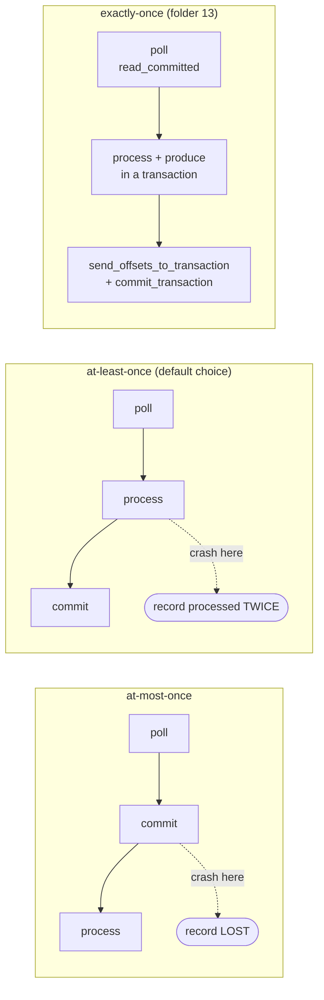

# 04 — Consumers: unlocking data (KiA ch. 5 · Definitive Guide ch. 4 · AKiA ch. 9)

> Goal: understand the poll loop, offsets and commits, and how to read from *anywhere* in the log.
> Consumer **groups and rebalancing** have their own folder: `05-consumer-groups-rebalancing`.

## Setup
```bash
make up && source .venv/bin/activate
python 04-consumers/00_seed_data.py        # kinaction_orders: 3 partitions x 10 records, 1/min over the last 30 min
```

## Scripts

| # | Script | Book § | You learn |
|---|--------|--------|-----------|
| 1 | `01_consumer_basics.py` | KiA 5.1, DG "poll loop" | coordinates (topic/partition/offset), no order across partitions, fetch long-polling |
| 2 | `02_auto_offset_reset.py` | KiA 5.1.1 | `earliest`/`latest` only apply when the group has **no** committed offset |
| 3 | `03_manual_commit_at_least_once.py` | KiA 5.4, DG "commits" | at-least-once (duplicates after crash) vs at-most-once (loss after crash) |
| 4 | `04_seek_and_replay.py` | KiA 5.4, DG "specific offsets" | seek to beginning / offset / **timestamp** (`offsets_for_times` → `.timeindex`) |
| 5 | `05_assign_vs_subscribe.py` | DG "standalone consumer" | `assign()` = no group, no rebalance |
| 6 | `06_multi_threaded_consumer.py` | DG "one consumer per thread" | poll thread + workers, commit only finished work |
| 7 | `07_compacted_topic_reader.py` | KiA 5.5 | build a table from a compacted topic, tombstones, offset gaps |
| 8 | `08_commits_sync_async_shutdown.py` | DG "combining sync+async commits", "how do we exit" | async commits in the loop, sync on revoke/shutdown, clean exit |

### The crash experiment (do this one!)
```bash
python 04-consumers/03_manual_commit_at_least_once.py --mode at-least-once --crash-after 12
python 04-consumers/03_manual_commit_at_least_once.py --mode at-least-once
#  -> the 2nd run starts at the last COMMITTED offset (10), so records 10 and 11 are processed twice.
python 04-consumers/03_manual_commit_at_least_once.py --mode at-most-once --crash-after 12
python 04-consumers/03_manual_commit_at_least_once.py --mode at-most-once
#  -> the record committed just before the crash was never processed: lost.
```
> The 2nd run can sit for up to **45s** before getting partitions: the crashed member is still in the group until
> `session.timeout.ms` expires (it never sent `LeaveGroup`). That's exactly the rebalance delay studied in folder 05.

## Where are offsets stored?
In the internal compacted topic **`__consumer_offsets`** (50 partitions). Key = (group, topic, partition), value = offset + metadata.
The group's *coordinator* is the leader of partition `abs(groupId.hashCode()) % 50`. See `07-topics-partitions-internals/04_consumer_offsets_internals.py`.

```bash
bin/groups --describe --group commit-demo-at-least-once       # CURRENT-OFFSET, LOG-END-OFFSET, LAG per partition
bin/groups --group G --topic kinaction_orders --reset-offsets --to-earliest --execute   # rewind (group must be inactive)
```

## Consumer configs cheat sheet

| Config | Default | Meaning |
|---|---|---|
| `group.id` | – | consumers with the same id share partitions |
| `auto.offset.reset` | latest | earliest / latest / error — when no committed offset |
| `enable.auto.commit` | true | commit in background every `auto.commit.interval.ms` (5s). Can commit *before* you processed → possible loss |
| `fetch.min.bytes` / `fetch.wait.max.ms` | 1 / 500 | broker holds the fetch until enough bytes or time (throughput vs latency) |
| `max.partition.fetch.bytes` | 1 MiB | per partition per fetch |
| `session.timeout.ms` | 45000 | no heartbeat for this long → member declared dead → rebalance |
| `heartbeat.interval.ms` | 3000 | background heartbeats (~1/3 of session timeout) |
| `max.poll.interval.ms` | 300000 | max time between `poll()` calls before the member is kicked out |
| `isolation.level` | read_committed | skip aborted transactional records (folder 13) |
| `partition.assignment.strategy` | range,roundrobin | or `cooperative-sticky` (folder 05) |

## Delivery semantics recap
```
at-most-once : commit → process        crash in between = LOSS
at-least-once: process → commit        crash in between = DUPLICATE   (make processing idempotent!)
exactly-once : read_committed + transactions (consume-transform-produce)  → folder 13
```

<!-- mermaid: at-most-once : commit -->

