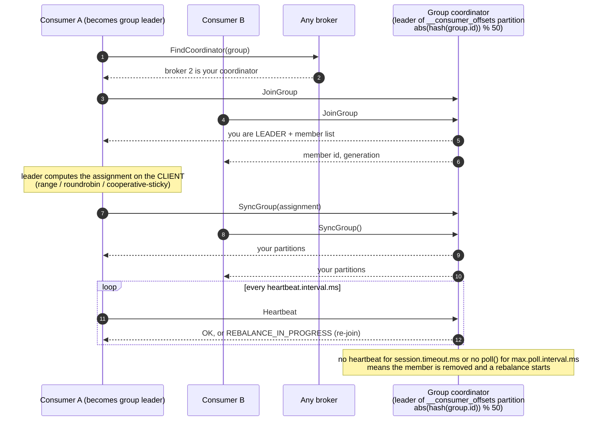

# 05 — Consumer groups & rebalancing (KiA 5.2–5.3 · DG ch. 4 "Consumer groups and partition rebalance" · AKiA 9.4)

> Goal: run **several consumer instances on one machine**, kill / stop / add them, and *watch* the group coordinator
> move partitions around. Compare **eager** vs **cooperative** rebalancing and **static membership**.

## Files

| File | Purpose |
|---|---|
| `producer_steady.py` | ~30 msg/s keyed traffic into `kinaction_rebalance` (6 partitions) |
| `consumer_worker.py` | one group member; prints `ASSIGNED` / `REVOKED` / `LOST` and per-partition throughput every 5s |
| `group_watch.py` | coordinator view: group state, members, assignment, **lag per partition** (refreshes every 2s) |
| `run_scenario.sh` | scripted timeline: join → join → join → graceful leave → crash → over-subscribe |

## Quick start (automated)
```bash
bash 05-consumer-groups-rebalancing/run_scenario.sh                      # eager protocol (range)
bash 05-consumer-groups-rebalancing/run_scenario.sh roundrobin
bash 05-consumer-groups-rebalancing/run_scenario.sh cooperative-sticky   # incremental rebalancing
STATIC=1 bash 05-consumer-groups-rebalancing/run_scenario.sh             # static membership
```
All members print into one colour-coded timeline (`[A]`, `[B]`, ...).

## Manual mode (recommended the 2nd time — one terminal per instance)
```bash
# terminal 1
python 05-consumer-groups-rebalancing/producer_steady.py
# terminal 2
python 05-consumer-groups-rebalancing/group_watch.py
# terminals 3,4,5
python 05-consumer-groups-rebalancing/consumer_worker.py --name A
python 05-consumer-groups-rebalancing/consumer_worker.py --name B
python 05-consumer-groups-rebalancing/consumer_worker.py --name C
```
Now: Ctrl+C one of them (graceful), or find its pid (printed at start) and `kill -9 <pid>` (crash). Keep Grafana's
**Consumer groups** row open: *Members per group*, *Consumer lag by partition*, *Group states*.

## What you will see (real output from this lab)

**Eager (range)** — everybody stops, everything is re-handed out:
```
### 2. B joins
[A] REVOKED  -[0,1,2,3,4,5] -> now owns []          <- stop-the-world: A gives up EVERYTHING
[A] ASSIGNED +[0,1,2]
[B] ASSIGNED +[3,4,5]
### 4. B stops GRACEFULLY
[B] leaving: close() -> commit + LeaveGroup
[A] REVOKED  -[0,1]   [C] REVOKED -[4,5]            <- rebalance within ~1s
[A] ASSIGNED +[0,1,2] [C] ASSIGNED +[3,4,5]
### 5. C CRASHES (kill -9)
[A] owns [0,1,2] ...  (p3,p4,p5 are NOT consumed — lag grows)
... ~10s later (session.timeout.ms) ...
[A] ASSIGNED +[0,1,2,3,4,5]   processed last 5s: p3:66 p4:54 p5:73   <- catching up the backlog
```

**Cooperative-sticky** — only the partitions that move are revoked; the others keep flowing:
```
### 2. B joins
[A] REVOKED  -[0,1,2] -> now owns [3,4,5]           <- A keeps processing 3,4,5 during the rebalance!
[B] ASSIGNED +[0,1,2]                                <- second round hands out the freed partitions
### 3. C joins
[B] REVOKED -[0]   [A] REVOKED -[3]                  <- one partition each moves to C
[C] ASSIGNED +[0,3]
```

**Static membership** (`group.instance.id`) — B is `kill -9`'d and restarted within the session timeout:
```
[B] ASSIGNED +[2,3]      <- same partitions back, A and C were never revoked => no rebalance at all
```

## How it works

```
 consumer ──FindCoordinator(group)──▶ any broker → "broker 2 is your coordinator"
            (leader of __consumer_offsets partition  abs(hash(group.id)) % 50)
 consumer ──JoinGroup──▶ coordinator   (all members re-join; first one becomes the group LEADER)
 leader   computes the assignment with the chosen assignor (range / roundrobin / sticky) ON THE CLIENT
 all      ──SyncGroup──▶ coordinator → each member receives its partitions
 members  ──Heartbeat (heartbeat.interval.ms)──▶ coordinator; reply "REBALANCE_IN_PROGRESS" triggers re-join
```

<!-- mermaid: FindCoordinator -->


### What triggers a rebalance
1. A member joins (new instance started).
2. A member leaves gracefully (`close()` → `LeaveGroup`) — immediate.
3. A member stops heart-beating for `session.timeout.ms` (crash, network partition, long GC) — **delayed**.
4. A member doesn't call `poll()` within `max.poll.interval.ms` (slow processing) → it's kicked out (`LOST`).
5. Subscribed topics change (partitions added, regex subscription matches a new topic).

Try #4: `python 05-consumer-groups-rebalancing/consumer_worker.py --name SLOW --slow-ms 3000 --max-poll-interval-ms 10000`
(librdkafka needs `max.poll.interval.ms` ≥ `session.timeout.ms`; with 3s per record it exceeds 10s after a few polls → `LOST`).

### Assignment strategies
| Strategy | Protocol | Behaviour |
|---|---|---|
| `range` (Java default part 1) | eager | per topic: contiguous ranges; can be uneven with many topics |
| `roundrobin` | eager | round-robin over all partitions of all topics; even |
| `cooperative-sticky` | **cooperative** | keeps existing assignments, moves the minimum, no stop-the-world |
| *KIP-848 `group.protocol=consumer`* | server-side | Kafka 4.0+: broker computes assignment, no global sync barrier |

> All members of a group must use compatible strategies. Switching eager → cooperative in production needs a two-step rolling bounce.

### Tuning knobs
| Config | Lab value | Default | Effect |
|---|---|---|---|
| `session.timeout.ms` | 10000 | 45000 | how fast a *crashed* member is detected |
| `heartbeat.interval.ms` | 2000 | 3000 | ~1/3 of session timeout |
| `max.poll.interval.ms` | 300000 | 300000 | max processing time between polls |
| `group.instance.id` | `--static` | unset | static membership: restarts don't rebalance |
| `group.initial.rebalance.delay.ms` (broker) | 0 | 3000 | wait for more members before first assignment |

### More consumers than partitions?
Extra members get **nothing** (step 6 of the scenario). Partitions = max parallelism of a group. Plan partition counts for the
peak number of consumers you'll ever need.

### Multiple groups = pub/sub
Start `consumer_worker.py --name X --group analytics` next to the scenario: it receives **all** partitions independently.
Each group has its own committed offsets.

## CLI equivalents
```bash
bin/groups --list
bin/groups --describe --group kinaction_rebalance_group --members --verbose   # members + assignment
bin/groups --describe --group kinaction_rebalance_group --state               # Stable / PreparingRebalance / ...
bin/groups --describe --group kinaction_rebalance_group                       # lag per partition
```
