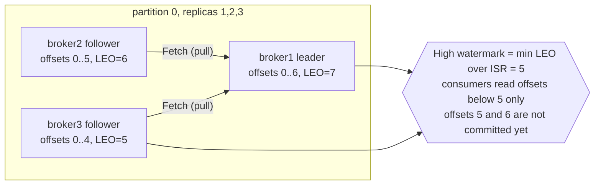

# 06 — Brokers, replication & failover (KiA ch. 6 · DG ch. 5 "Replication" + ch. 6 "Reliable delivery" · AKiA 5.3, 8.4)

> Goal: kill brokers while a producer is writing, and *see* leader election, ISR shrink/expand, preferred-leader
> rebalancing, `NOT_ENOUGH_REPLICAS`, unclean election — then **prove** no acknowledged record was lost.

## Concepts

```
partition 0  replicas=[1,2,3]                       LEO = log end offset (next offset to write on THAT replica)
 broker1 (leader)   [0][1][2][3][4][5][6]  LEO=7    HW  = high watermark = min LEO over the ISR
 broker2 (follower) [0][1][2][3][4][5]     LEO=6          consumers can only read below the HW
 broker3 (follower) [0][1][2][3][4]        LEO=5    →  HW=5: offsets 5,6 are not yet "committed"
```

<!-- mermaid: LEO = log end offset -->

* **Followers pull** (Fetch requests, like consumers) from the leader. A follower that hasn't caught up within
  `replica.lag.time.max.ms` (30s) is removed from the **ISR**.
* `acks=all` = the leader waits until every *ISR* replica has the record. If ISR size < `min.insync.replicas`
  the leader **refuses** the write (`NOT_ENOUGH_REPLICAS`) — this is what makes acks=all safe.
* **Leader election**: when a leader dies the controller picks a new leader *from the ISR* and bumps the **leader epoch**.
  Followers truncate any divergent uncommitted tail using the epoch (KIP-101), so no "ghost" records.
* **Preferred leader** = first replica in the list. After restarts leadership is skewed until a preferred election runs
  (`auto.leader.rebalance.enable=true` does this every 5 min).
* **Rack awareness**: brokers here have `broker.rack=rack-a/b/c` → replicas are spread across racks/AZs.

| Durability recipe | Value |
|---|---|
| `replication.factor` | 3 |
| `min.insync.replicas` | 2 |
| producer `acks` | all (+ `enable.idempotence=true`) |
| `unclean.leader.election.enable` | false |
| consumer | commit after processing |
→ survives the loss of any one broker without losing an acknowledged write *and* stays writable.

## Scripts
| File | What |
|---|---|
| `01_watch_leaders.py` | live leader/replicas/ISR table with change highlighting (`--once` for a snapshot) |
| `02_durable_producer.py` | acks=all producer, logs every ACKED sequence number to `acked.log`, shows retriable errors |
| `03_verify_no_data_loss.py` | DG "validating reliability": every acked record must be in the topic |
| `failover_scenario.sh` | automated: stop 1 broker → restart → preferred election → stop 2 → restart → verify |
| `reassign_partitions.sh` | `kafka-reassign-partitions` generate / execute (throttled) / verify — moving replicas off a broker |
| `unclean_leader_election.sh` | provoke an offline partition, then enable unclean election and **lose data** on purpose |

## Run it
```bash
bash 06-brokers-replication-failover/failover_scenario.sh
```
Or manually in 3 terminals:
```bash
python 06-brokers-replication-failover/01_watch_leaders.py          # T1
python 06-brokers-replication-failover/02_durable_producer.py       # T2
docker stop kafka2        # T3 ... watch T1 + Grafana, then:
docker start kafka2
bin/kafka-cli kafka-leader-election --bootstrap-server kafka1:29092 --election-type PREFERRED --all-topic-partitions
docker stop kafka2 kafka3 # producer starts reporting NOT_ENOUGH_REPLICAS ... then start them again
# Ctrl+C the producer, then:
python 06-brokers-replication-failover/03_verify_no_data_loss.py
```
Try again with `02_durable_producer.py --acks 1` and stop the **leader** broker of busy partitions with `docker kill` (SIGKILL):
acks=1 may lose records that the leader acked but followers never copied.

## What to watch in Grafana (Kafka Labs dashboard)
* **Brokers up** 3 → 2, **Under-replicated partitions** > 0 while a broker is down, back to 0 after it rejoins.
* **Offline partitions** > 0 only in the unclean-election demo (no ISR member alive).
* **Leader partitions per broker**: broker that restarted has 0 leaders until the preferred election.
* **ISR shrinks / expands per sec** spikes.
* Prometheus alerts at http://localhost:9090/alerts: `KafkaBrokerDown`, `KafkaUnderReplicatedPartitions`.

## Broker-level things from the books worth knowing
* **Request processing** (DG ch. 5): network threads (`num.network.threads`) accept requests into a request queue; I/O threads
  (`num.io.threads`) process them; produce requests with acks=all wait in **purgatory** until followers catch up;
  fetch requests wait in purgatory until `fetch.min.bytes` is available.
* **Zero-copy**: fetch responses are sent from page cache to socket via `sendfile()` — why Kafka is fast and why
  it loves RAM for page cache rather than JVM heap (6 GB heap is plenty).
* **Rolling upgrade / restart** (KiA 6.5.3): one broker at a time, wait for *Under-replicated partitions = 0* between brokers.
* **Adding a broker**: new brokers get *no* existing partitions automatically → use `reassign_partitions.sh` (or Cruise Control).
* **Backups** (KiA 6.5.5, AKiA 16.2): replication isn't a backup (a `delete-topic` replicates too). Use MirrorMaker 2 to another
  cluster (`19-mirrormaker2-disaster-recovery`) or a sink connector to object storage.
