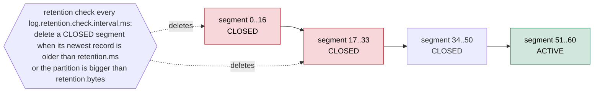
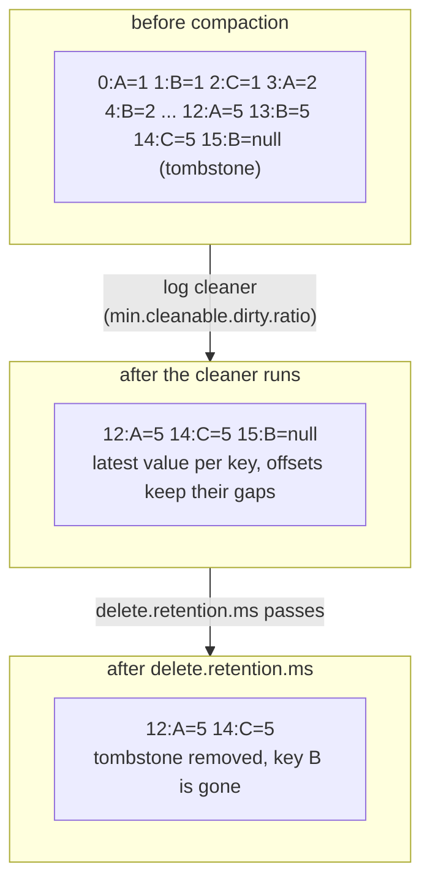

# 08 — Storage: retention, compaction & reprocessing (KiA ch. 8 · DG ch. 5 "Compaction" · AKiA ch. 10)

> Goal: understand **how long Kafka keeps data and how it gets rid of it**: time and size retention, `delete_records`,
> log compaction with tombstones, and why long retention enables the **Kappa architecture**.

## Scripts
| # | Script | Book § | What you see |
|---|--------|--------|--------------|
| 1 | `01_time_retention.py` | KiA 8.1, AKiA 10.3 | low watermark jumping by **whole segments** as `retention.ms` expires |
| 2 | `02_size_retention_and_delete_records.py` | AKiA 10.3 | `retention.bytes` (per partition) and `AdminClient.delete_records()` |
| 3 | `03_compaction_deep_dive.py` | DG "How compaction works", "Deleted events"; AKiA 10.4 | before/after compaction, offsets with gaps, tombstone visible then removed |
| 4 | `04_kappa_replay.py` | KiA 8.5 | rebuild a *new* view by replaying the log with a new consumer group |

Also see `04-consumers/07_compacted_topic_reader.py` (table from a compacted topic).

## Retention (cleanup.policy=delete)
```
segments:  [0..16] [17..33] [34..50] [51..60 ACTIVE]
            ^ deletable when CLOSED and its newest record is older than retention.ms
              (or the partition is bigger than retention.bytes)
```

<!-- mermaid: segments:  [0..16] -->

* Checked every `log.retention.check.interval.ms` (5 min default; 10s in this lab).
* Effective lifetime ≈ `retention.ms` + up to `segment.ms`/`segment.bytes` of the active segment.
* `retention.bytes` is **per partition**: topic size ≈ retention.bytes × partitions × RF.
* `retention.ms=-1` = keep forever (event sourcing, Kappa). Pair it with tiered storage in production.

## Compaction (cleanup.policy=compact)
```
before:  0:A=1 1:B=1 2:C=1 3:A=2 4:B=2 ... 12:A=5 13:B=5 14:C=5 15:B=∅(tombstone)
after :  12:A=5 14:C=5 15:B=∅          ← latest per key, offsets keep their gaps
later :  12:A=5 14:C=5                 ← tombstone dropped after delete.retention.ms
```

<!-- mermaid: before:  0:A=1 -->

| Config | Default | Meaning |
|---|---|---|
| `min.cleanable.dirty.ratio` | 0.5 | clean when dirty bytes / total ≥ ratio |
| `min.compaction.lag.ms` | 0 | records younger than this are never compacted (guarantee a minimum history) |
| `max.compaction.lag.ms` | ∞ | force compaction after this long (e.g. GDPR deadlines) |
| `delete.retention.ms` | 24h | how long tombstones survive after compaction |
| `segment.ms` | 7d | active segment is never compacted → roll it to make data eligible |
| `log.cleaner.threads` (broker) | 1 | cleaner threads; the cleaner is a background thread on each broker |

Uses: latest state per entity (CDC tables — folder 16), `__consumer_offsets`, Kafka Streams changelogs, config topics of Kafka Connect.

## Moving data in and out (KiA 8.2–8.4)
* Keep the **original event** in Kafka, derive views downstream; don't transform before writing.
* Export to long-term storage with sink connectors (S3/HDFS — folder 15) or **Debezium** for DB → Kafka (folder 16).
* **Tiered storage** (KIP-405, GA in Kafka 3.9): old segments offloaded to object storage, transparent to consumers —
  infinite retention without huge broker disks. (`remote.storage.enable=true` per topic.)

## Lambda vs Kappa (KiA 8.5)
| | Lambda | Kappa |
|---|---|---|
| layers | batch (recompute from a data lake) + speed (stream) + serving merge | stream only |
| reprocess | rerun batch job | replay the topic with a new consumer group / new app id |
| code | two codebases with the same logic | one |
| needs | data lake | long retention / tiered storage in Kafka |

## Multi-cluster & cloud (KiA 8.6–8.7)
Mirroring between clusters → `19-mirrormaker2-disaster-recovery`. Kubernetes operators (Strimzi, Confluent for Kubernetes) run Kafka
as StatefulSets with persistent volumes — the same retention/segment rules apply to those volumes.
