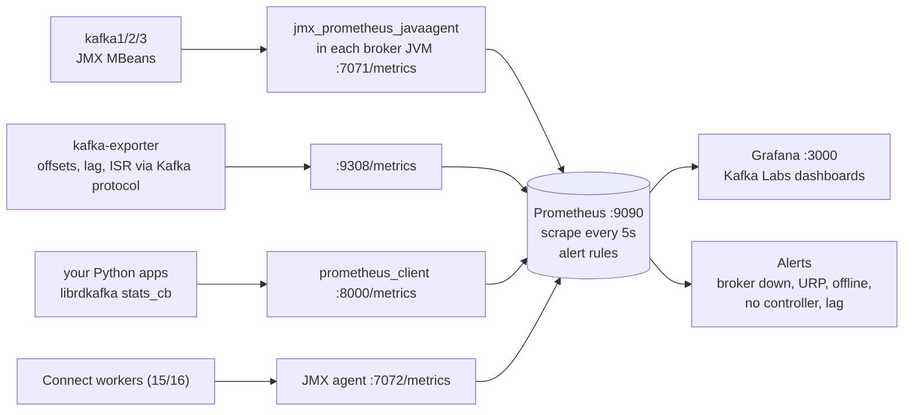

# 10 — Monitoring with Prometheus & Grafana (KiA 9.5 · DG ch. 10 "Monitoring Kafka" · AKiA ch. 15 + appendix B)

> Goal: know **which metrics tell you Kafka is healthy**, where they come from, and see them move while you break things.

## How the monitoring stack is wired (all started by `make up`)

```
 kafka1/2/3 ── JMX MBeans ──▶ jmx_prometheus_javaagent (in each broker JVM, :7071/metrics) ──┐
 kafka-exporter (danielqsj) ── Kafka protocol: offsets, lag, ISR ──▶ :9308/metrics ─────────┤
 your Python apps ── librdkafka stats_cb ──▶ prometheus_client :8000/metrics ───────────────┤
 connect (folder 15/16) ── JMX agent :7072 ─────────────────────────────────────────────────┤
                                                                                            ▼
                                         Prometheus :9090 (scrape every 5s, alert rules) ──▶ Grafana :3000
```

<!-- mermaid: JMX MBeans -->

| File | Purpose |
|---|---|
| `infra/jmx-exporter/kafka-broker.yml` | which MBeans become which Prometheus metrics (curated, commented) |
| `infra/prometheus/prometheus.yml` | scrape jobs |
| `infra/prometheus/alerts.yml` | alert rules: broker down, under-replicated, offline partitions, no controller, lag |
| `infra/grafana/dashboards/kafka-labs.json` | **Kafka Labs — Cluster Overview** dashboard |
| `infra/grafana/dashboards/kafka-labs-clients.json` | **Kafka Labs — Python clients** dashboard |

URLs: Grafana http://localhost:3000 (no login) · Prometheus http://localhost:9090 (try *Alerts* and *Graph*) · raw broker metrics http://localhost:9090/targets.
To see the raw exporter output: `docker exec kafka1 curl -s localhost:7071/metrics | grep -i underreplicated`.

## Scripts
| # | File | What |
|---|------|------|
| 1 | `01_lag_generator.py` | producer + N consumers with a configurable processing time → make lag grow or shrink on demand |
| 2 | `02_client_metrics_exporter.py` | librdkafka statistics → Prometheus (`rdkafka_*` metrics), scraped as job `python-clients` |
| 3 | `03_check_alerts.sh` | targets + alert states from the CLI |

### Experiment 1 — consumer lag & scaling out
```bash
python 10-monitoring-prometheus-grafana/01_lag_generator.py --produce-rate 200 --consumers 1 --process-ms 20
#  capacity 50/s < 200/s  -> Grafana "Consumer lag" climbs; after 30s alert KafkaConsumerLagHigh fires (>1000)
# Ctrl+C, then scale out (same group, offsets kept):
python 10-monitoring-prometheus-grafana/01_lag_generator.py --produce-rate 200 --consumers 6 --process-ms 20
#  capacity 300/s -> lag drains. Try --consumers 8: no faster than 6 (only 6 partitions!)
```
### Experiment 2 — broker failure
Run `06-brokers-replication-failover/failover_scenario.sh` and watch *Brokers up*, *Under-replicated partitions*,
*Leader partitions per broker*, *ISR shrinks/expands*. `bash 10-monitoring-prometheus-grafana/03_check_alerts.sh` shows alerts firing.
### Experiment 3 — client view
```bash
python 10-monitoring-prometheus-grafana/02_client_metrics_exporter.py --rate 500
```
Open dashboard **Kafka Labs — Python clients**: send rate, producer queue, batch size, broker RTT, client-side lag.
Then `docker stop kafka2` → RTT/queue spikes on the client side while the broker metrics show the URP.

## The metrics that matter (DG ch. 10, AKiA 15.2–15.4)

### Broker / cluster
| Metric (this lab's name) | MBean | Healthy | Why |
|---|---|---|---|
| `kafka_server_replicamanager_underreplicatedpartitions` | `kafka.server:type=ReplicaManager,name=UnderReplicatedPartitions` | 0 | **the** single most important broker metric (DG): a broker is down/slow/overloaded |
| `kafka_controller_offlinepartitionscount` | `kafka.controller:type=KafkaController,name=OfflinePartitionsCount` | 0 | partitions without a leader = outage |
| `kafka_controller_activecontrollercount` | `...ActiveControllerCount` | sum = 1 | 0 = no controller; >1 = split brain |
| `kafka_server_replicamanager_isrshrinkspersec_total` | `...IsrShrinksPerSec` | ~0 | flapping followers (network, GC, disk) |
| `kafka_server_request_handler_avg_idle_ratio` | `KafkaRequestHandlerPool RequestHandlerAvgIdlePercent` | > 0.3 | I/O threads saturated below 20-30% |
| `kafka_network_processor_avg_idle_ratio` | `SocketServer NetworkProcessorAvgIdlePercent` | > 0.3 | network threads saturated |
| `kafka_network_request_total_time_ms{request="Produce"}` | `RequestMetrics TotalTimeMs` | stable | latency; breakdown also has Queue/Local/Remote/ResponseSend time |
| `kafka_server_brokertopicmetrics_*persec_total` | `BrokerTopicMetrics` | — | bytes/messages in/out, per topic |
| `kafka_server_replicamanager_leadercount` / `partitioncount` | | balanced | skew = hot broker |
| `kafka_log_size`, `kafka_log_numlogsegments` | `kafka.log:type=Log` | — | disk usage per partition |
| `jvm_heap_bytes`, `jvm_gc_collection_time_ms_total` | `java.lang` | — | long GC pauses → session timeouts, ISR shrinks |
| host: disk usage, disk IO, network, open file handles | node_exporter | — | Kafka is mostly a disk + network workload |

### Clients
| Metric | Where | Meaning |
|---|---|---|
| **consumer lag** (`kafka_consumergroup_lag`, `rdkafka_consumer_lag`) | kafka-exporter / client | the #1 consumer health metric — alert on *growing* lag, not on a fixed number. Burrow-style evaluation is even better |
| `kafka_consumergroup_members` | kafka-exporter | members disappearing = crashes/rebalances |
| producer queue / record-error-rate / request-latency | client | broker slowness seen from the app |
| rebalance count / rate | client | frequent rebalances = slow processing or unstable members |

### Alerting philosophy (AKiA 15.4)
* Page on **symptoms** (offline partitions, no controller, consumer lag growing for N minutes, broker down for > X min).
* Ticket on **causes** (URP for a short time, disk at 70%, ISR shrink rate).
* Always use `for:` durations — restarts cause short, harmless URP spikes.

## End-to-end monitoring (DG ch. 10)
Run a canary producer/consumer that writes a timestamped message every few seconds to every broker and alerts when it isn't
received in time (Xinfra Monitor, formerly Kafka Monitor, does exactly this). `09-admin-tools/05_tracing_headers.py` shows the idea.
