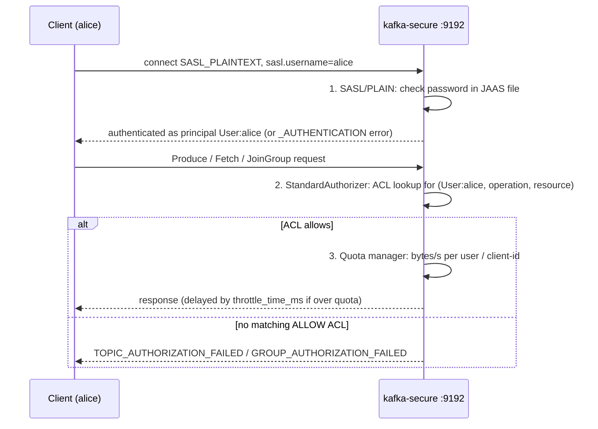

# 11 — Security: authentication, ACLs, quotas, TLS

| Book | Sections |
|---|---|
| Kafka in Action (KiA) | ch. 10 *Protecting Kafka* — 10.1 SSL, 10.2 Kerberos/SASL, 10.3 ACLs & RBAC, 10.5 quotas, 10.6 data at rest |
| Kafka: The Definitive Guide (DG, 2017) | ch. 2 broker config (listeners), ch. 6 reliability, ch. 9 admin (`kafka-acls`, `kafka-configs` quotas) |
| Apache Kafka in Action (AKiA) | 13.2 Security, 13.3 Quotas |

> Goal: lock a cluster down and *see* each layer reject a request:
> **authentication** (who are you?) → **authorization** (what may you do?) → **quotas** (how much?) → **encryption** (who can read the wire / disk?).

This folder runs its **own single-broker secured cluster** on `localhost:9192` so the main lab cluster stays open.

```
 client ──SASL_PLAINTEXT :9192──▶ kafka-secure
   │   sasl.username=alice           │ 1. SASL/PLAIN: check password in JAAS file      -> principal User:alice
   │   sasl.password=...             │ 2. StandardAuthorizer: ACL lookup per request   -> ALLOW / DENY
   │                                 │ 3. Quota manager: bytes/s per user/client-id    -> delay response (throttle)
```

<!-- mermaid: SASL_PLAINTEXT :9192 -->


## Start / stop
```bash
docker compose -f 11-security-sasl-acls-quotas/docker-compose.yml up -d     # ~20s until healthy
docker compose -f 11-security-sasl-acls-quotas/docker-compose.yml down -v
```
Users (in `config/kafka_server_jaas.conf`): `admin/admin-secret` (super user), `alice/alice-secret`, `bob/bob-secret`.

Key broker settings (see `docker-compose.yml`):

| Setting | Value | Why |
|---|---|---|
| `listener.security.protocol.map` | `EXTERNAL:SASL_PLAINTEXT,...` | every client must authenticate |
| `sasl.enabled.mechanisms` | `PLAIN` | simplest mechanism; production → SCRAM / OAUTHBEARER / mTLS, over TLS |
| `authorizer.class.name` | `org.apache.kafka.metadata.authorizer.StandardAuthorizer` | KRaft authorizer (ZooKeeper clusters: `kafka.security.authorizer.AclAuthorizer`) |
| `allow.everyone.if.no.acl.found` | `false` | deny by default |
| `super.users` | `User:admin;User:ANONYMOUS` | admin bypasses ACLs; ANONYMOUS = internal PLAINTEXT controller listener |

## Exercises

### 1. Authentication — `01_authentication.py`
```bash
python 11-security-sasl-acls-quotas/01_authentication.py
```
Expected: correct password → OK; wrong password / unknown user → `_AUTHENTICATION`; no SASL → connection dropped.
Note alice "sees" no topics yet: even **metadata is authorized** (DESCRIBE).

### 2. Authorization with ACLs — `02_acls.py`
```bash
python 11-security-sasl-acls-quotas/02_acls.py          # demo
python 11-security-sasl-acls-quotas/02_acls.py --cleanup
```
1. alice produces with no ACL → `TOPIC_AUTHORIZATION_FAILED`
2. grant alice WRITE, bob READ on the topic + READ on groups **prefixed** `billing-` → alice produces OK
3. bob consumes as `billing-xxxx` → OK; as `marketing-xxxx` → `GROUP_AUTHORIZATION_FAILED`
4. `describe_acls` prints the ACL table

Common ACL recipes (CLI, run inside the container):
```bash
CLI="docker exec kafka-secure kafka-acls --bootstrap-server kafka-secure:29192 --command-config /etc/kafka/lab/admin.properties"
$CLI --list
$CLI --add --allow-principal User:alice --producer --topic sec_orders                 # WRITE+DESCRIBE+CREATE
$CLI --add --allow-principal User:bob --consumer --topic sec_orders --group 'billing-' --resource-pattern-type prefixed
$CLI --add --allow-principal User:alice --operation Write --transactional-id 'tx-' --resource-pattern-type prefixed
$CLI --add --deny-principal User:bob --operation Read --topic sec_orders --allow-host 10.0.0.66   # DENY beats ALLOW
```

| Client type | Needs |
|---|---|
| Producer | WRITE (+DESCRIBE) on topic; transactional: WRITE+DESCRIBE on TRANSACTIONAL_ID |
| Consumer | READ (+DESCRIBE) on topic **and** READ on GROUP |
| Admin tools | CREATE / DELETE / ALTER / ALTER_CONFIGS / DESCRIBE_CONFIGS on topic or CLUSTER |
| Kafka Connect / Streams | the union of the above + their internal topics (prefixed ACLs on app id) |

**RBAC** (KiA 10.3.2) is a Confluent Platform commercial feature layered on top: roles (DeveloperRead, ResourceOwner…) bound to principals/groups from LDAP.

### 3. Quotas — `03_quotas.py` (run after 02 so alice can write)
```bash
python 11-security-sasl-acls-quotas/03_quotas.py
```
Sets `producer_byte_rate=512KB/s` for `User:alice`. The broker never rejects — it computes a **throttle time**
and delays the response / mutes the connection, so alice's average converges to ~0.5 MB/s. Then the quota is removed → ~50+ MB/s.
```bash
docker exec kafka-secure kafka-configs --bootstrap-server kafka-secure:29192 --command-config /etc/kafka/lab/admin.properties \
  --alter --entity-type users --entity-name alice --add-config 'producer_byte_rate=1048576,consumer_byte_rate=2097152,request_percentage=50'
docker exec kafka-secure kafka-configs ... --alter --entity-type clients --entity-default --add-config producer_byte_rate=10485760   # default for all client-ids
```

### 4. TLS / mTLS — `scripts/gen-certs.sh`
```bash
bash 11-security-sasl-acls-quotas/scripts/gen-certs.sh     # needs openssl (+ keytool for a JKS/PKCS12 truststore)
```
Creates a lab CA, a broker certificate (SAN `kafka-secure`, `localhost`) and a client certificate `CN=alice`,
then prints the broker and Python client settings. With `ssl.client.auth=required` the client certificate's
DN becomes the principal (`User:CN=alice`) — map it with `ssl.principal.mapping.rules`.

## Concepts recap

**Encryption in transit (KiA 10.1)** — `SSL` listener (TLS 1.2/1.3). Costs CPU and disables zero-copy `sendfile`
for consumers (data must be encrypted in user space). Broker↔broker: `security.inter.broker.protocol=SSL`.

**SASL mechanisms (KiA 10.2)**

| Mechanism | Credentials stored | Notes |
|---|---|---|
| PLAIN | JAAS file (or custom callback) | password in clear → **only with TLS** |
| SCRAM-SHA-256/512 | in the cluster metadata (`kafka-configs --alter --add-config 'SCRAM-SHA-512=[password=..]' --entity-type users`) | add/remove users without restart. KRaft: bootstrap with `kafka-storage format --add-scram` |
| GSSAPI (Kerberos) | KDC / Active Directory | the book's Kerberos example; enterprise standard |
| OAUTHBEARER | external IdP (Keycloak, Okta, Azure AD) issues JWTs | KIP-768 OIDC support; token refresh |
| mTLS | client certificates | no passwords; cert rotation is the hard part |

**ZooKeeper security (KiA 10.4)** — only for ZK-based clusters: `zookeeper.set.acl=true` + SASL to ZK. KRaft removes this surface.

**Data at rest (KiA 10.6)** — Kafka does not encrypt log segments. Options: disk/volume encryption (LUKS, EBS/KMS),
or **end-to-end payload encryption** in the producer (envelope encryption with a KMS key, e.g. Confluent CSFLE) so brokers only see ciphertext.

## Clean up
```bash
python 11-security-sasl-acls-quotas/02_acls.py --cleanup
docker compose -f 11-security-sasl-acls-quotas/docker-compose.yml down -v
```
