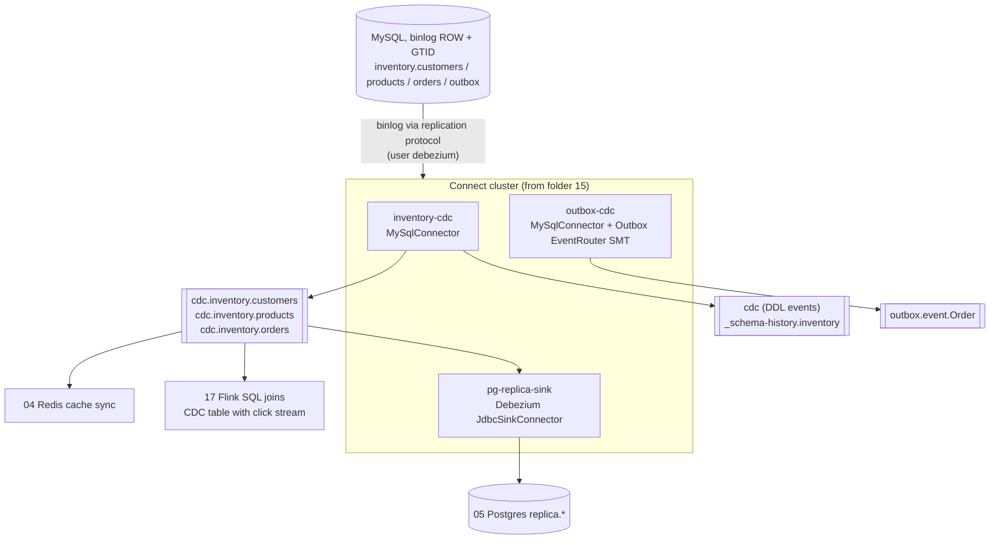

# 16 — Change Data Capture with Debezium (MySQL → Kafka → Redis / Postgres)

> Goal: turn **every committed INSERT / UPDATE / DELETE** in MySQL into a Kafka event, read from the binlog
> (not by polling), and use that stream to keep a Redis cache and a Postgres replica in sync. Then handle
> schema changes, connector outages, and the transactional **outbox** pattern.

| Book | Chapter / section |
|------|-------------------|
| Kafka in Action (KiA) | 8.3.2 *Red Hat Debezium*, 8.2 data movement ("keeping the original event"), 5.5 compacted topics |
| Kafka: The Definitive Guide (DG, 2017) | ch. 7 *Building Data Pipelines* — "Connector Example: MySQL to Elasticsearch" (here with binlog CDC and Postgres/Redis as targets), *Failure handling*, *Coupling and agility* |
| Apache Kafka in Action (AKiA) | 11.9 *Change data capture connector*; 18.2 *Liberating data from core systems with Kafka* |

## Why CDC instead of the JDBC source (folder 15)?

| JDBC source (polling) | Debezium (log-based CDC) |
|---|---|
| `SELECT ... WHERE id > ?` every N seconds | reads the **binlog** like a MySQL replica |
| misses DELETEs | DELETE events + tombstones |
| merges changes between polls (insert+delete = nothing) | every committed change, in commit order |
| needs `id` / `updated_at` columns | works on any table with a primary key |
| loads the DB with queries | negligible load; latency in ms |
| no "before" values | `before` and `after` row images |

## Architecture

```
 ┌──────────── MySQL (binlog ROW, GTID) ────────────┐
 │ inventory.customers / products / orders / outbox │
 └──────────────┬───────────────────────────────────┘
                │ binlog (replication protocol, user "debezium")
     ┌──────────▼─────────── Connect cluster (from 15) ─────────────┐
     │ inventory-cdc  (MySqlConnector, 1 task)                       │
     │ outbox-cdc     (MySqlConnector + Outbox EventRouter SMT)      │
     │ pg-replica-sink(Debezium JdbcSinkConnector)                   │
     └───┬─────────────────────┬───────────────────────────┬────────┘
         ▼                     ▼                           ▼
  cdc.inventory.customers   cdc (DDL events)        outbox.event.Order
  cdc.inventory.products    _schema-history.inventory (internal)
  cdc.inventory.orders
     │            │                    │
     ▼            ▼                    ▼
 04 Redis     05 Postgres          17 Flink SQL joins
 cache sync   replica.*            (CDC table ⋈ click stream)
```

<!-- mermaid: MySQL (binlog ROW, GTID) -->


## The change event (envelope)

Key = primary key `{"id": 1}` ⇒ all changes of one row go to the **same partition, in order**.

```jsonc
{ "before": {"id":1,"city":"Austin", ...},      // null for create / snapshot read
  "after":  {"id":1,"city":"Dallas", ...},      // null for delete
  "op": "u",                                    // r=snapshot read, c=create, u=update, d=delete, t=truncate
  "ts_ms": 1793897451234,                       // when Debezium processed it
  "source": { "connector":"mysql", "db":"inventory", "table":"customers",
              "file":"mysql-bin.000003", "pos":10468, "gtid":"…:44",
              "snapshot":"false", "ts_ms":1793897451230 } }   // commit time in MySQL → lag = ts_ms - source.ts_ms
```
A DELETE produces **two** records: `op=d` (with `before`) and a **tombstone** (key, `null` value) so a compacted topic can forget the key.
Because these topics are compacted, a new consumer can always rebuild the *current* table state from offset 0.

## Start

```bash
make up                                                          # Kafka cluster
docker compose -f 16-cdc-debezium-mysql/docker-compose.yml up -d --build
#   = 15's stack (connect, connect-2, mysql, postgres) via `include:` + redis
```

| Service | Host port | Credentials |
|---|---|---|
| Connect REST | 8083 / 8084 | – |
| MySQL | 3306 | root/rootpw, debezium/dbz |
| Postgres | 5433 | postgres/postgres (db `warehouse`, schema `replica`) |
| Redis | 6379 | – |

## Scripts (run in order, from the repo root)

| # | Script | What you learn |
|---|---|---|
| 0 | `00_setup_inventory.py` | creates `inventory` (customers, products, orders, outbox); shows `binlog_format=ROW`, `binlog_row_image=FULL`, GTID, the debezium user's grants |
| 1 | `01_register_debezium_mysql.py` | connector config explained line by line; snapshot → streaming; topics + stored binlog offset |
| 2 | `02_cdc_envelope_decoder.py [--follow]` | decodes op / before / after / diff / source position / snapshot flag / lag / tombstones / DDL |
| 3 | `03_generate_changes.py [-n 0 --rate 5]` | random business transactions (multi-table tx, multi-row UPDATE ⇒ many events) |
| 4 | `04_redis_cache_sync.py [--follow] [--verify]` | cache sync with idempotent upserts/deletes, commit-after-write; verifies Redis == MySQL |
| 5 | `05_postgres_replica_jdbc_sink.py` | Debezium **JDBC sink**: upsert + delete + auto-create into `replica.*`; insert/update/delete verified |
| 6 | `06_schema_change.py` | `ALTER TABLE ADD COLUMN` while streaming: DDL event, schema history, new field downstream, Postgres column auto-added |
| 7 | `07_outbox_pattern.py` | transactional outbox + **Outbox EventRouter** → `outbox.event.Order`, key = aggregate id, `eventType` header |
| 8 | `08_restart_and_resume.py` | connector stopped while DB changes → resumes from stored binlog position, nothing lost |

Two-terminal live demo:
```bash
python 16-cdc-debezium-mysql/02_cdc_envelope_decoder.py --follow       # terminal 1
python 16-cdc-debezium-mysql/03_generate_changes.py -n 0 --rate 2      # terminal 2
python 16-cdc-debezium-mysql/04_redis_cache_sync.py --follow           # terminal 3 (optional)
docker exec -it redis redis-cli HGETALL customer:1
docker exec -it postgres psql -U postgres -d warehouse -c 'select * from replica.customers'
```

## Key connector settings (`01_register_debezium_mysql.py`)

| Setting | Why |
|---|---|
| `database.server.id` | Debezium joins as a replica; must be unique (outbox connector uses another id) |
| `topic.prefix=cdc` | topic names `cdc.<db>.<table>`; also the logical server name in offsets — **never change it** for a running pipeline |
| `snapshot.mode=initial` | snapshot existing rows once, then stream. Others: `no_data` (schema only), `when_needed`, `never`, `initial_only` |
| `schema.history.internal.kafka.topic` | DDL history so old binlog events can be parsed after restart (1 partition, infinite retention) |
| `include.schema.changes` | DDL events to topic `cdc` |
| `decimal.handling.mode=double` | avoid base64-encoded DECIMALs (see 15/03); use `string` for money if precision matters |
| `tombstones.on.delete` | emit null-value record after delete (needed for compaction) |
| `topic.creation.default.*` | Debezium creates the topics: 3 partitions, RF 3, `cleanup.policy=compact` |
| converters with `schemas.enable=true` | the JDBC sink and Flink's `debezium-json` need the types |

## Guarantees & gotchas
* **Ordering**: per primary key (one partition per key). Across tables / keys there is no global order — the `source.gtid` / `pos` tell you the DB commit order if you need it.
* **At-least-once**: after a crash Debezium re-reads from the last *flushed* offset → duplicates possible. Consumers must be idempotent (upsert by key — as in 04 and 05).
* **Binlog retention**: if the connector is down longer than `binlog_expire_logs_seconds`, its position is gone → the connector fails; re-snapshot.
* **Primary key changes** produce a delete (old key) + create (new key).
* **Transactions**: one MySQL transaction touching N rows ⇒ N events (optionally `provide.transaction.metadata=true` adds BEGIN/END markers).
* **Large snapshots** lock nothing with InnoDB + `REPEATABLE READ` but can take hours — consider incremental snapshots (signal table).

## The outbox pattern (07)
Writing to the DB **and** to Kafka from an application is a *dual write*: one can succeed while the other fails.
Instead, write the business row and an event row to an `outbox` table in the **same local transaction**; Debezium publishes
the outbox inserts. The EventRouter SMT routes by `aggregatetype` to `outbox.event.<type>`, uses `aggregateid` as key
and `payload` as value, and can put `type` into a header. Delete the outbox row immediately — the binlog keeps the insert.

## Monitoring
Prometheus scrapes the worker JMX endpoint (`connect:7072`); Debezium exports e.g.
`debezium_streaming_millisecondsbehindsource`, `debezium_streaming_totalnumberofeventsseen`, `debezium_streaming_connected`,
`debezium_snapshot_snapshotcompleted`, `debezium_snapshot_remainingtablecount`.
> The task runs on whichever worker the cluster chose; add `connect-2:7072` to `infra/prometheus/prometheus.yml` to scrape both workers.

## Exercises
1. Stop `04_redis_cache_sync.py`, run `03` for a while, start it again — it catches up from its committed offset.
2. `bin/topics --describe --topic cdc.inventory.customers` → note `cleanup.policy=compact`. Why does that make the topic a replayable copy of the table?
3. Change a primary key (`UPDATE customers SET id=100 WHERE id=4`) and watch the decoder: delete + tombstone + create.
4. Set `snapshot.mode=no_data` in 01 and re-register: no `op=r` events, only new changes.
5. Use the `ExtractNewRecordState` SMT (`io.debezium.transforms.ExtractNewRecordState`, `delete.handling.mode=rewrite`) to publish flat rows instead of envelopes — what do consumers lose?

## Stop
```bash
docker compose -f 16-cdc-debezium-mysql/docker-compose.yml down -v
```
Next: **17-flink-sql** — join the CDC table stream with a click stream in Flink SQL.
