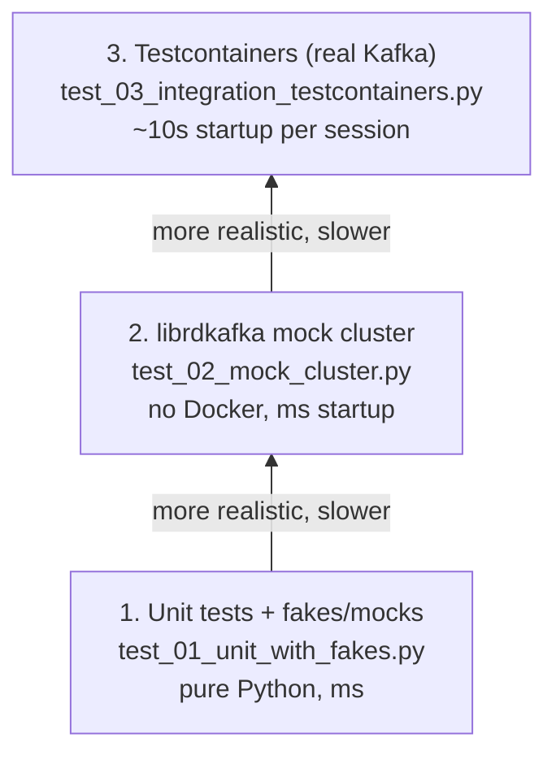

# 18 — Testing Kafka applications (KiA ch. 7.3 · DG ch. 6 "Validating System Reliability")

> Goal: a **testing pyramid** for Kafka code — fast unit tests with fakes, librdkafka's in-process mock cluster,
> and real-broker integration tests with **Testcontainers** — all runnable with one `pytest` command.

```
            ▲ slower, more realistic
   ┌────────────────────────────────┐
   │ 3. Testcontainers (real Kafka) │  test_03_integration_testcontainers.py   ~10s startup / session
   ├────────────────────────────────┤
   │ 2. librdkafka mock cluster     │  test_02_mock_cluster.py                 no Docker, ms startup
   ├────────────────────────────────┤
   │ 1. Unit tests + fakes/mocks    │  test_01_unit_with_fakes.py              pure Python, ms
   └────────────────────────────────┘
            ▼ faster, more isolated
```

<!-- mermaid: slower, more realistic -->


## Files

| File | What |
|---|---|
| `app.py` | Tiny "application": `to_order_event()` (pure function) and `OrderPublisher` (producer injected → testable) |
| `conftest.py` | Fixtures: `kafka_bootstrap` (session-scoped Testcontainers broker), `topic` (fresh random topic per test), `mock_bootstrap` (librdkafka mock cluster) |
| `test_01_unit_with_fakes.py` | Key choice, validation, a hand-written `FakeProducer`, `unittest.mock` |
| `test_02_mock_cluster.py` | Round trip through `test.mock.num.brokers=3` — real client code, fake broker |
| `test_03_integration_testcontainers.py` | Round trip, **same key ⇒ same partition ⇒ ordered**, **group resumes from committed offset**, idempotent producer, publisher vs real Kafka |
| `pytest.ini` | Marks `integration` tests |

## Run

```bash
source .venv/bin/activate
pytest 18-testing-testcontainers                      # everything (Docker must be running)
pytest 18-testing-testcontainers -m "not integration" # only fast tests (no Docker)
KAFKA_TEST_BOOTSTRAP=localhost:9092 pytest 18-testing-testcontainers   # reuse the lab cluster instead of a container
```
Expected: `11 passed` in ~30s (first run pulls `confluentinc/cp-kafka:7.7.1` if missing).

## Design rules that make Kafka code testable

1. **Inject the producer/consumer** (constructor argument) — never create it at import time.
2. **Separate pure logic** (serialization, key choice, validation) from I/O. Most bugs live there and need no broker.
3. **One broker per test session, one topic per test** (random names) — fast *and* isolated.
4. **Never `sleep()` and hope** — poll with a bounded loop until you have N records or a timeout.
5. Assert on **Kafka semantics you rely on**: per-key ordering, resume-after-commit, no duplicates.
6. For the Java world: `EmbeddedKafkaCluster` / `TopologyTestDriver` (Kafka Streams) are what KiA ch. 7.3 shows; Testcontainers is the language-agnostic equivalent.

## Reliability validation (DG ch. 6)
The Definitive Guide recommends validating the *whole system*, not only code:
* **Configuration validation** — `kafka-verifiable-producer` / `kafka-verifiable-consumer` (available via `bin/kafka-cli`) with the acks/min.insync settings you plan to run:
  ```bash
  bin/kafka-cli kafka-verifiable-producer --bootstrap-server kafka1:29092 --topic verify --max-messages 1000 --acks -1
  bin/kafka-cli kafka-verifiable-consumer --bootstrap-server kafka1:29092 --topic verify --group-id v1 --max-messages 1000
  ```
* **Failure injection** — while those run, `docker stop kafka2` (see `06-brokers-replication-failover`) and check every acknowledged message is still consumed.
* **Monitoring in production** — Grafana dashboard + alerts in `infra/prometheus/alerts.yml`.
