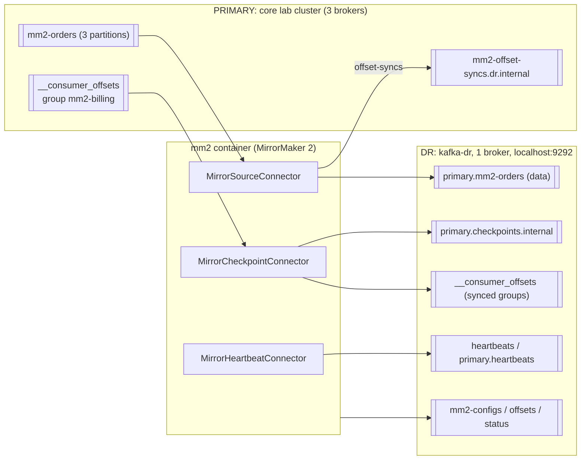

# 19 — MirrorMaker 2 & disaster recovery (DG ch. 8 · AKiA ch. 16 · KiA ch. 8.6)

> Goal: run a second Kafka cluster ("DR site"), mirror topics into it with **MirrorMaker 2**, understand
> **remote topic naming**, **offset translation (checkpoints)** and actually **fail a consumer over** to DR.

```
 PRIMARY (core lab cluster, 3 brokers)                    DR (kafka-dr, 1 broker, localhost:9292)
 ┌──────────────────────────┐   MirrorSourceConnector   ┌────────────────────────────────────┐
 │ mm2-orders  (3 parts)    │ ────────────────────────▶ │ primary.mm2-orders   (data)        │
 │ __consumer_offsets       │   MirrorCheckpointConn.   │ primary.checkpoints.internal       │
 │   group mm2-billing      │ ────────────────────────▶ │ __consumer_offsets (synced groups) │
 │ mm2-offset-syncs.dr.int. │ ◀── offset-syncs (source)  │ heartbeats / primary.heartbeats    │
 └──────────────────────────┘   MirrorHeartbeatConn.    │ mm2-{configs,offsets,status}.*     │
                                     (mm2 container)    └────────────────────────────────────┘
```

<!-- mermaid: PRIMARY (core lab cluster -->


## Files

| File | Purpose |
|---|---|
| `docker-compose.yml` | `kafka-dr` (single-node KRaft, port **9292**, auto-create **off**) + `mm2` (`connect-mirror-maker` dedicated mode). Joins network `kafka-labs`. |
| `mm2.properties` | MM2 config — every line commented: aliases, flows, topic/group regex, checkpoint & offset sync, replication factors |
| `mm2_common.py` | Constants + a Python decoder for MM2 checkpoint records (port of `Checkpoint.java`) |
| `01_produce_on_primary.py` | Creates `mm2-orders` (3 partitions) on primary, produces N records |
| `02_consume_on_primary.py` | Group `mm2-billing` consumes *part* of it and commits |
| `03_inspect_dr.py` | Topics on DR, replication lag per partition, **decoded checkpoints**, offsets MM2 committed on DR |
| `04_failover_consumer.py` | Primary is "gone": resume on DR — `--mode translate` (RemoteClusterUtils logic) or `--mode synced` |
| `run_demo.sh` | All of the above in sequence |

## Run

```bash
make up                                                        # core cluster
docker compose -f 19-mirrormaker2-disaster-recovery/docker-compose.yml up -d
python 19-mirrormaker2-disaster-recovery/01_produce_on_primary.py -n 300
python 19-mirrormaker2-disaster-recovery/02_consume_on_primary.py --max 120
sleep 30                                                       # let MM2 mirror + checkpoint
python 19-mirrormaker2-disaster-recovery/03_inspect_dr.py
python 19-mirrormaker2-disaster-recovery/04_failover_consumer.py --mode translate
docker compose -f 19-mirrormaker2-disaster-recovery/docker-compose.yml down -v
```
(or `bash 19-mirrormaker2-disaster-recovery/run_demo.sh`). MM2 logs: `docker logs -f mm2`.

### What you'll see (real output from this lab)
```
Checkpoints for group mm2-billing
  primary.mm2-orders[0] upstream(primary) offset=120 -> downstream(dr) offset=120
  primary.mm2-orders[2] upstream(primary) offset=30  -> downstream(dr) offset=12
```
Partition 2: the group committed 30 on the primary, but the translated DR offset is **12**. MM2 only knows
offset pairs from the *offset-syncs* it emitted (every `offset.lag.max` records), so it translates to the latest
**safe** point at or before the real position. After failover the consumer re-reads offsets 12–29 →
**DR failover is at-least-once**. Make consumers idempotent.

## Key concepts

### Remote topic naming (`DefaultReplicationPolicy`)
`<source-alias>.<topic>` → `primary.mm2-orders`. This lets **active-active** work without infinite loops: MM2 never
re-mirrors a topic that already carries the target's prefix. Apps that must run on both sides subscribe by regex
(`.*mm2-orders`). `IdentityReplicationPolicy` keeps the same name (only safe for one-way active-passive / migrations).

### Offsets differ between clusters
Offsets are assigned by each cluster independently. If the DR topic was created later, after retention deleted
data, or records were filtered, offset 500 on primary ≠ offset 500 on DR. Hence **checkpoints**:
`MirrorCheckpointConnector` reads the group's committed offsets on primary, translates them with the
offset-syncs topic, and writes `<alias>.checkpoints.internal` on DR. With `sync.group.offsets.enabled=true` it
also commits them into DR's `__consumer_offsets` (only for groups with no active members on DR).

### Architectures (DG ch. 8 "Multicluster Architectures")
| Pattern | How | Pros | Cons |
|---|---|---|---|
| **Hub & spokes** | many local clusters → one central aggregate cluster | simple, local writes | central is read-only aggregate |
| **Active-active** | both DCs take writes, MM2 both ways | no idle DC, users served locally | conflicts if the same key is written in both; consumers must handle prefixed topics |
| **Active-standby (this lab)** | one-way primary → DR | simplest; easy to reason about | idle hardware; failover is manual; data loss = replication lag (RPO), offsets approximate |
| **Stretch cluster** | ONE cluster across 3 DCs/AZs with `broker.rack` + `acks=all`, `min.insync.replicas` | no MM2, exact offsets, sync replication | needs low-latency links; ≥3 DCs |

### Failover checklist (DG "Planning failover")
1. Detect + decide (automatic failover of *clients* is risky; usually a human decides).
2. Stop producers to primary (avoid split-brain), point them to DR (DNS / config).
3. Consumers: use translated offsets (this lab) — or fall back to `auto.offset.reset` + idempotent processing, or a timestamp (`offsets_for_times`) a few minutes before the incident.
4. **Failback**: primary has stale + possibly unreplicated data. Usually wipe and re-mirror DR → primary, then switch back.

### Backups (AKiA ch. 16.2)
Kafka has no built-in "backup" command. Options:
* **Replication is not a backup** (a `delete topic` or bad producer replicates too).
* Mirror to another cluster with a longer retention (this lab), possibly in another region/account.
* Sink connectors to object storage (S3/GCS sink, Parquet) — restore by re-producing; offsets change.
* Disk snapshots of broker volumes (consistent only per broker; complicated).
* Back up *metadata*: topic configs, ACLs, schemas (`_schemas` topic), Connect configs — as code (GitOps/Terraform).
* Tiered storage (KIP-405, Kafka 3.6+) keeps old segments in object storage but is not a backup by itself.

## Exercises
1. `docker stop mm2`, produce 100 more on primary, run `03` → lag grows. `docker start mm2` → catches up (it stores its own source offsets in `mm2-offsets.primary.internal`).
2. Add `dr->primary.enabled = true` + `dr->primary.topics = mm2-.*` → produce on DR to `mm2-orders` and watch `dr.mm2-orders` appear on primary (active-active). Note `primary.mm2-orders` is *not* mirrored back.
3. Change a topic config on primary (`bin/topics --alter ...` or `kafka-configs --alter --entity-type topics --entity-name mm2-orders --add-config retention.ms=3600000`) and check it shows up on `primary.mm2-orders` (sync.topic.configs).
