# 20 — Performance tuning (AKiA ch. 6 & 14 · DG ch. 2 "Hardware/OS/Broker config" · KiA ch. 4–5)

> Goal: *measure* before tuning. Use Kafka's own perf tools and a Python matrix to see which knobs actually
> move throughput and latency, and learn the broker/OS/hardware settings from the books.

## Scripts (repo root, core cluster up)

| # | Script | What it measures |
|---|---|---|
| 1 | `01_producer_perf_test.sh [N]` | `kafka-producer-perf-test` (Java client): acks × linger × batch × compression → records/s, MB/s, p50/p95/p99 latency |
| 2 | `02_consumer_perf_test.sh [N]` | `kafka-consumer-perf-test` with small vs large `max.partition.fetch.bytes` and `fetch.min.bytes` |
| 3 | `03_end_to_end_latency.sh` | `EndToEndLatency` tool: produce→replicate→consume time, acks=1 vs all |
| 4 | `04_broker_config_inspect.sh [id]` | The broker settings that matter (threads, socket buffers, segment, flush, replication) |
| 5 | `05_python_benchmark_matrix.py [--quick] [--csv f]` | librdkafka matrix: partitions, acks, linger/batch, compression; consumer fetch settings and `poll()` vs `consume(N)` |

Sample results from this lab (MacBook, Docker Desktop, 3 brokers, RF=3):
```
partitions acks linger   batch  compr      msg/s
         1  all      0   16384   none     65,705
         6  all      0   16384   none     21,098   <- many tiny requests: more partitions don't help without batching
         6    1      5  131072   none    748,159
         6  all      5  131072   none    573,192
         6  all     20 1048576    lz4  1,317,465   <- batching + compression = biggest win
consumer: poll() one-by-one 1.0M msg/s  vs  consume(1000) 2.0M msg/s
```

## Where the time goes (mental model)

```
producer: serialize → partition → batch (linger.ms, batch.size) → compress → send (max.in.flight)
                                                                       │ network
broker  : network thread (num.network.threads) → request queue (queued.max.requests)
          → I/O thread (num.io.threads) append to page cache → wait for followers (acks=all,
            replica fetchers num.replica.fetchers) → response queue → network thread
consumer: fetch (fetch.min.bytes / fetch.max.wait.ms / max.partition.fetch.bytes) → zero-copy sendfile
          from page cache → decompress → deserialize → your code (usually the real bottleneck)
```

<!-- mermaid: producer: serialize -->


```mermaid
flowchart LR
    subgraph PROD["producer"]
        p1[serialize] --> p2[partition] --> p3["batch<br/>linger.ms, batch.size"] --> p4[compress] --> p5["send<br/>max.in.flight"]
    end
    subgraph BROKER["broker"]
        b1["network thread<br/>num.network.threads"] --> b2["request queue<br/>queued.max.requests"] --> b3["I/O thread<br/>num.io.threads<br/>append to page cache"] --> b4["wait for followers (acks=all)<br/>num.replica.fetchers"] --> b5[response queue] --> b6[network thread]
    end
    subgraph CONS["consumer"]
        c1["fetch<br/>fetch.min.bytes, fetch.max.wait.ms,<br/>max.partition.fetch.bytes"] --> c2["zero-copy sendfile<br/>from page cache"] --> c3[decompress] --> c4[deserialize] --> c5["your code<br/>(usually the real bottleneck)"]
    end
    p5 -- network --> b1
    b6 --> c1
```

## Producer knobs (AKiA 6.2, DG ch. 3 "Configuring Producers")
| Setting | Throughput ↑ | Latency / safety trade-off |
|---|---|---|
| `linger.ms` 5–50 | bigger batches, fewer requests | adds up to linger ms latency |
| `batch.size` 64K–1M | bigger batches | memory per partition |
| `compression.type` lz4/zstd | less network + disk + replication | client CPU |
| `acks=1` | ~20–40 % faster | can lose data on leader failure |
| `max.in.flight.requests.per.connection` | pipelining | keep ≤5 with idempotence |
| `buffer.memory` (Java) / `queue.buffering.max.kbytes` (librdkafka) | absorbs bursts | `BufferError`/blocking when full |

## Consumer knobs (AKiA 6.4, DG ch. 4 "Configuring Consumers")
| Setting | Effect |
|---|---|
| `fetch.min.bytes` / `fetch.max.wait.ms` | fewer, larger fetches vs latency on quiet topics |
| `max.partition.fetch.bytes`, `fetch.max.bytes` | data per request (must be ≥ largest record batch) |
| `max.poll.records` (Java) / `consume(num_messages)` (Python) | records handed to your code per call |
| more **partitions + consumers** | the only way to scale processing horizontally (≤1 consumer per partition per group) |
| process in batches, async I/O, commit less often | usually bigger wins than any Kafka setting |

## Topic knobs (AKiA 6.1)
* **Partition count** = max consumer parallelism. Rough sizing: `max(target MB/s ÷ producer MB/s per partition, target MB/s ÷ consumer MB/s per partition)`. Over-provision a bit (re-partitioning breaks key ordering), but each partition costs file handles, memory, and leader-election/recovery time (keep < ~4000 per broker, < ~200k per cluster with KRaft).
* `segment.bytes` / `segment.ms`: smaller = faster retention/compaction granularity, more files.
* `min.insync.replicas` + `acks=all`: durability costs one follower round-trip.

## Broker knobs (DG ch. 2, AKiA 6.3)
| Setting | Default | Guidance |
|---|---|---|
| `num.network.threads` | 3 | raise if `NetworkProcessorAvgIdlePercent` < 0.3 |
| `num.io.threads` | 8 | ≥ number of disks; raise if `RequestHandlerAvgIdlePercent` < 0.3 |
| `num.replica.fetchers` | 1 | raise if followers lag (ISR shrinks under load) |
| `num.recovery.threads.per.data.dir` | 1 | raise to speed up restarts after unclean shutdown (many partitions) |
| `socket.send/receive.buffer.bytes` | 100K | raise for high-latency (cross-DC) links |
| `log.flush.interval.*` | never (OS decides) | **leave it** — durability comes from replication, not fsync |
| `replica.lag.time.max.ms` | 30000 | how long a follower may lag before leaving ISR |
| `log.dirs` | one dir | list several disks (JBOD) — partitions spread across them |
Change most of them dynamically: `bin/kafka-cli kafka-configs --bootstrap-server kafka1:29092 --alter --entity-type brokers --entity-default --add-config num.io.threads=16`.

## OS & hardware (DG ch. 2 "Hardware Selection" / "OS Tuning", AKiA ch. 14.3)
* **Memory**: the broker heap needs only ~4–6 GB; give the rest to the **page cache** — consumers reading recent data are served from RAM (zero-copy `sendfile`). Size RAM ≈ producer MB/s × seconds of data consumers lag behind.
* **Disk**: throughput > IOPS (sequential writes). Several disks (JBOD) or RAID10; XFS; mount `noatime`. Don't share disks with other I/O-heavy apps.
* **Network**: usually the first bottleneck. Replication multiplies inbound traffic by RF; consumer groups multiply outbound.
* **CPU**: matters with compression (if broker must recompress — avoid by matching `compression.type=producer`), TLS, many partitions.
* **Linux**: `vm.swappiness=1`, `vm.dirty_background_ratio=5`, `vm.dirty_ratio=60–80`, raise `vm.max_map_count` and file-descriptor limits (`nofile` ≥ 100k: each segment = 2–3 files), `net.core.wmem_max/rmem_max`, `net.ipv4.tcp_window_scaling=1`.
* **JVM**: G1GC (default), `-Xms=-Xmx` 4–6 GB, `MaxGCPauseMillis=20`.
* **Cluster sizing**: brokers ≥ max(disk needed ÷ disk per broker, throughput ÷ ~60–80 % of NIC per broker, RF). Keep headroom for a broker failure (its traffic moves to the others).

## What to watch in Grafana (http://localhost:3000, "Kafka Labs — Cluster Overview") while running the scripts
* **Throughput** row: messages/bytes in per topic (`perf-test`, `perf-matrix-6`).
* **Request latency** row: Produce p99 jumps with `acks=all` and big batches; Fetch p99 reflects `fetch.max.wait.ms`.
* **Request handler idle % / Network processor idle %**: approach 0 = broker saturated → add threads/brokers.
* **Replication bytes in** and **ISR shrinks**: followers struggling to keep up under load.
* **Consumer lag**: run `02_consumer_perf_test.sh` with a slow consumer to see lag rise and drain.
