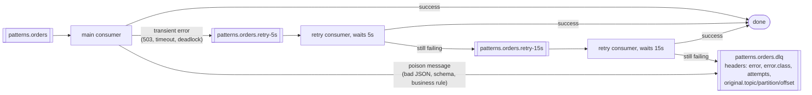

# 22 — Patterns: retries & DLQ, request-reply, claim-check — and where Kafka fits (AKiA ch. 17–18 · DG ch. 6–7 · KiA ch. 3)

> Goal: production patterns that every Kafka team ends up building, plus the architecture discussion
> "when is Kafka the right tool — and when is it not?"

## Scripts (repo root, core cluster up)

| # | Script | Pattern |
|---|---|---|
| 1 | `01_retry_topics_and_dlq.py` | Non-blocking **retry topics** with increasing delay (5s, 15s) + **DLQ**; poison pills skip retries |
| 2 | `02_dlq_replay.py [--replay KEY ...]` | Inspect DLQ (error headers) and **replay** fixed records to the main topic |
| 3 | `03_request_reply.py` | **Request-reply** with `correlation-id` + `reply-to` headers and Futures with timeouts |
| 4 | `04_claim_check.py` | **Claim-check**: 5 MB blob → object store, Kafka carries a 344-byte reference + checksum |

## 1. Retries, poison pills and DLQs

```
patterns.orders ─▶ main consumer ─✔─▶ done
       │  Transient (503, timeout, deadlock)          Poison (bad JSON, schema, business rule)
       ▼                                                │
patterns.orders.retry-5s ─▶ retry-15s ─(still failing)─▶ patterns.orders.dlq  ◀─┘
                                                         headers: error, error.class, attempts,
                                                                  original.topic/partition/offset
```

<!-- mermaid: patterns.orders ─▶ main consumer -->

Real output:
```
  ✘ o2 -> DLQ (not JSON ...)                         poison: straight to DLQ, no retries
  ↻ o4 -> patterns.orders.retry-5s (attempt 1)
  ↻ o4 -> patterns.orders.retry-15s (attempt 2)
[retry-15s] ✔ processed order o4                     transient: recovered on 3rd attempt
  ✘ o5 -> DLQ (payment service unavailable (attempt 3))   retries exhausted
```
**Design rules**
* Classify errors: **retriable** (transient infra) vs **non-retriable** (poison). Retrying poison forever blocks the partition ("stuck consumer").
* **Blocking retries** (retry in place with backoff) keep per-key order but stall the partition — fine for short outages, dangerous for long ones (`max.poll.interval.ms`).
* **Retry topics** keep the main flow moving but **break per-key ordering** for retried records. If order matters per key, park *all* later records of that key too (or use blocking retries).
* Always **commit after handing off** to the retry/DLQ topic → nothing is lost (at-least-once; make processing idempotent).
* Deserialization errors are poison too — catch them in your deserializer wrapper and route to DLQ.
* Kafka Connect: `errors.tolerance=all`, `errors.deadletterqueue.topic.name`, `errors.deadletterqueue.context.headers.enable=true` (see `15-kafka-connect`).
* Monitor DLQ size (alert on any growth) — see `10-monitoring-prometheus-grafana`.

## 2. Request-reply
* Requester adds `correlation-id`, `reply-to` (topic) and here `reply-partition` headers; the service answers to that destination with the same correlation id; the requester completes the matching Future.
* Each requester *instance* must receive its own replies: dedicated reply partition (this lab), per-instance reply topic, or a shared group + a shared store for results.
* Always use timeouts; late replies for timed-out requests must be ignored.
* Prefer REST/gRPC for simple synchronous queries. Use Kafka request-reply when requests must be durable/queued, survive restarts, be load-balanced across a consumer group, or be observed by other services. (Spring Kafka's `ReplyingKafkaTemplate` implements the same idea.)

## 3. Claim-check
Kafka's default record size limit is ~1 MB (`message.max.bytes`, `max.request.size`, `fetch.max.bytes`, `replica.fetch.max.bytes` must all agree to raise it). Instead: store the blob, send `{uri, sha256, size, content_type}`. Upload **before** producing; immutable, content-addressed objects; store lifecycle ≥ topic retention.

## Kafka vs other technologies (AKiA ch. 17)

| | Kafka | Classic broker (RabbitMQ, ActiveMQ, JMS, SQS) | REST | Relational DB |
|---|---|---|---|---|
| Model | append-only **log**, consumers track offsets | **queue**, broker tracks per-message acks, deletes on ack | synchronous request/response | mutable current state, queries |
| Re-read / replay | ✅ any time within retention | ❌ gone after ack (except some streams features) | ❌ | ✅ current state only, history needs CDC |
| Many independent consumers | ✅ cheap (consumer groups) | fan-out via exchanges/topics, copies per queue | callers must call each service | polling |
| Ordering | per partition | per queue (lost with competing consumers) | n/a | n/a |
| Per-message routing / priorities / delays / TTL | ❌ (build it: see retry topics) | ✅ rich | – | – |
| Throughput | very high (batching, sequential I/O, zero-copy) | moderate | per call | moderate for writes |
| Coupling | producers don't know consumers (temporal + spatial decoupling) | low | **high** (both must be up) | shared schema coupling |
| Best for | event streaming, integration backbone, CDC, logs/metrics, stream processing | task queues, complex routing, RPC-ish work distribution | queries, commands needing an immediate answer | transactions on current state, ad-hoc queries |

**Data on the outside vs. data on the inside (AKiA 17.1):** a service's database is *inside* data (private, mutable, optimized for that service). Events on Kafka are *outside* data — immutable, versioned (schemas!), shared contracts. Don't expose your internal tables 1:1 as topics; publish meaningful domain events (outbox pattern / CDC with transformation — see `16-cdc-debezium-mysql`).

## Kafka in modern architectures (AKiA ch. 18)
* **Streaming platform core**: Kafka (storage + transport) + Connect (integration) + Schema Registry (contracts) + Streams/ksqlDB/Flink (processing).
* **Data mesh**: domains own and publish *data products* as well-governed topics (schema, SLA, owner, documentation, access control); Kafka is the self-serve infrastructure; a central team provides the platform, not the data.
* **Liberating data from core systems**: CDC (Debezium) from mainframes/ERP/legacy DBs → topics → new services, without touching the legacy app (strangler pattern).
* **Big data**: Kafka as the ingestion buffer in front of data lakes/warehouses (S3/Iceberg/Snowflake/BigQuery sinks); Kappa architecture = reprocess by replaying the log (KiA ch. 8.5).
* **IIoT**: sensors → MQTT gateways → Kafka (cf. the factory example in `02-designing-events`).

### What Kafka is **not** (AKiA 18.5)
* Not a database for ad-hoc queries (no indexes by value; use ksqlDB/Flink materialized views or sink to a DB).
* Not a request/response RPC system or a low-latency (< ms) trading bus.
* Not a large-file store (claim-check!).
* Not a job queue with per-message priorities, delays, TTL or individual acks (Kafka 4.x "share groups"/KIP-932 adds queue-like consumption, still early).
* Not "free" to operate — partitions, retention, schemas and consumer lag need ownership.
