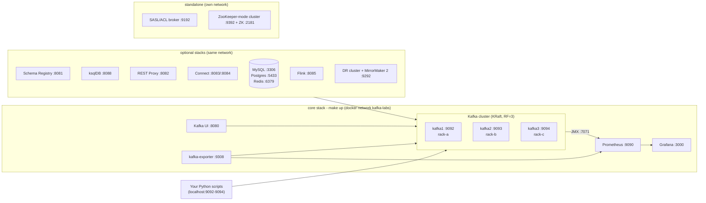

# Kafka Labs — learn Apache Kafka by running it

Hands-on, runnable **Python + Docker** labs that walk through three books chapter by chapter:

| Abbrev. | Book |
|---|---|
| **KiA** | *Kafka in Action* — Dylan Scott, Viktor Gamov, Dave Klein (Manning, 2022) |
| **DG** | *Kafka: The Definitive Guide* — Neha Narkhede, Gwen Shapira, Todd Palino (O'Reilly, 1st ed., 2017) |
| **AKiA** | *Apache Kafka in Action: From Basics to Production* — Anatoly Zelenin, Alexander Kropp (Manning, 2025) |

Every folder is a self-contained lesson: a **README** (concepts, diagrams, what to look for, book references), numbered
**scripts** you run in order, and a **docker-compose** file when extra services are needed. You *see* Kafka internals —
partitions on disk, record-batch bytes, consumer-group rebalances, leader election, ISR, compaction, transactions —
while **Prometheus + Grafana** show the cluster's health live.

> New here? Read **[SETUP.md](SETUP.md)**, run `make venv && make up`, then start with `01-hello-kafka`.

```
                     ┌────────────────────── core (make up) ───────────────────────┐
  your Python ──────▶│ kafka1:9092  kafka2:9093  kafka3:9094   (KRaft, RF=3, racks a/b/c) │
  scripts            │ Kafka UI :8080   Prometheus :9090   Grafana :3000   kafka-exporter │
                     └──────────────────────────────▲──────────────────────────────┘
      optional stacks (attach to docker network "kafka-labs"): │
      Schema Registry :8081 · ksqlDB :8088 · REST Proxy :8082 · Connect :8083/:8084 · MySQL :3306
      Postgres :5433 · Redis :6379 · Flink :8085 · DR cluster + MirrorMaker 2 :9292
      standalone: SASL/ACL broker :9192 · ZooKeeper-mode cluster :9392 (+ZK :2181)
```

<!-- mermaid: core (make up) -->


## Learning path

| # | Folder | You learn | KiA | DG | AKiA |
|---|--------|-----------|-----|----|------|
| 01 | [hello-kafka](01-hello-kafka) | topics, partitions, offsets, brokers, CLI + first Python producer/consumer | 1, 2 | 1 | 1, 2 |
| 02 | [designing-events](02-designing-events) | requirement → topic/key/config decisions, keys & ordering, compacted "status" topic | 3 | – | 3 |
| 03 | [producers](03-producers) | async vs sync, murmur2 partitioning (+ Python/Java gotcha), acks, batching & compression, idempotence (PID/sequence on disk), timestamps, headers, errors | 4 | 3 | 5.1, 6.2, 8.1 |
| 04 | [consumers](04-consumers) | poll loop, auto.offset.reset, commit strategies & crash experiment, seek/replay by time, assign vs subscribe, thread pools, compacted reads, graceful shutdown | 5 | 4 | 9 |
| 05 | [consumer-groups-rebalancing](05-consumer-groups-rebalancing) | **multiple instances on one machine**; join / graceful leave / kill -9 / over-subscription; eager vs cooperative; static membership; live lag view | 5.2–5.3 | 4 | 9.4 |
| 06 | [brokers-replication-failover](06-brokers-replication-failover) | leader election, ISR, min.insync.replicas, NOT_ENOUGH_REPLICAS, preferred leaders, reassignment, **unclean election data loss**, reliability verification | 6 | 5, 6 | 5.3, 8.4 |
| 07 | [topics-partitions-internals](07-topics-partitions-internals) | partition dirs & segment files, **parse a .log segment in Python**, indexes, `__consumer_offsets`, KRaft `__cluster_metadata`, replica placement | 7 | 5 | 4, 8.3 |
| 08 | [storage-retention-compaction](08-storage-retention-compaction) | time/size retention, delete_records, compaction + tombstones step by step, Kappa replay | 8 | 5 | 10 |
| 09 | [admin-tools](09-admin-tools) | AdminClient tour, CLI cheat sheet, kcat, REST Proxy, tracing headers, listeners, systemd | 9 | 9 | 7.4, 14.1 |
| 10 | [monitoring-prometheus-grafana](10-monitoring-prometheus-grafana) | broker JMX metrics, lag, client metrics exporter, alert rules, what to alert on | 9.5 | 10 | 15, App. B |
| 11 | [security-sasl-acls-quotas](11-security-sasl-acls-quotas) | SASL/PLAIN auth, ACLs (allow/deny), quotas & throttling, SSL/mTLS cert generation, SCRAM/OAuth notes | 10 | (security) | 13.2–13.3 |
| 12 | [schema-registry-avro](12-schema-registry-avro) | Avro + Schema Registry, wire format (magic byte + id), evolution & compatibility modes, custom serializers | 11 | 3 | 13.1 |
| 13 | [transactions-exactly-once](13-transactions-exactly-once) | transactional producer, read_committed, consume-transform-produce EOS, zombie fencing, control records on disk | 2.6.2 | 6 | 5.2 |
| 14 | [stream-processing-ksqldb](14-stream-processing-ksqldb) | stateless/stateful processing, tumbling & hopping windows, late data, stream-table join, changelog-backed state, ksqlDB | 12 | 11 | 12 |
| 15 | [kafka-connect](15-kafka-connect) | distributed Connect (2 workers), REST API, file source/sink, JDBC source/sink, SMTs, DLQ, task failover | 2.4.2 | 7 | 11 |
| 16 | [cdc-debezium-mysql](16-cdc-debezium-mysql) | **CDC**: Debezium MySQL, change-event envelope, Redis cache sync, Postgres replica, schema changes, outbox pattern, resume after downtime | 8.3.2 | 7 | 11.9 |
| 17 | [flink-sql](17-flink-sql) | Flink SQL on Kafka: windows, watermarks, CDC (debezium-json) joins, upsert-kafka, exactly-once sinks | – | 11 | 12 |
| 18 | [testing-testcontainers](18-testing-testcontainers) | unit tests with fakes, librdkafka mock cluster, integration tests with Testcontainers | 7.3 | 6 | – |
| 19 | [mirrormaker2-disaster-recovery](19-mirrormaker2-disaster-recovery) | second cluster, MirrorMaker 2, offset translation, consumer failover, DR architectures, backups | 8.6 | 8 | 16 |
| 20 | [performance-tuning](20-performance-tuning) | perf-test tools, end-to-end latency, Python benchmark matrix, broker/OS/hardware tuning | 4.2.2 | 2 | 6, 14.3 |
| 21 | [kraft-vs-zookeeper](21-kraft-vs-zookeeper) | ZooKeeper-mode cluster side by side, znodes, controller failover in both modes, metadata log, ZK→KRaft migration | 2.3.3, 6.2 | 2, 5 | 7 |
| 22 | [patterns-retry-dlq-request-reply](22-patterns-retry-dlq-request-reply) | retry topics + DLQ, poison pills, request-reply, claim check, Kafka vs MQ/REST/DB, data mesh | – | – | 17, 18 |

Suggested order: **01 → 10** is the core (≈ KiA parts 1–2 and DG ch. 1–6, 9–10). 11–22 can be done in any order.

### Highlights — the "aha" experiments
* **Kill consumers and watch partitions move** — `bash 05-consumer-groups-rebalancing/run_scenario.sh` (then `cooperative-sticky`, then `STATIC=1`).
* **Stop brokers under load and prove nothing acked was lost** — `bash 06-brokers-replication-failover/failover_scenario.sh`.
* **Lose data on purpose** with unclean leader election — `06-.../unclean_leader_election.sh`.
* **Read Kafka's on-disk bytes yourself** — `python 07-topics-partitions-internals/03_read_segment_in_python.py`.
* **Watch compaction remove old values and tombstones** — `python 08-storage-retention-compaction/03_compaction_deep_dive.py`.
* **Exactly-once survives a crash** — `13-transactions-exactly-once/03_exactly_once_pipeline.py`.
* **MySQL row change → Kafka → Redis / Postgres in under a second** — folder 16.

## Repository layout
```
infra/                 core docker-compose + Prometheus/Grafana/JMX exporter config (shared by every folder)
common/kafka_helpers.py  bootstrap servers, topic helpers, pretty printing (imported by all scripts)
bin/                   kafka-cli (any Kafka CLI inside a broker), topics, groups, kcat
NN-topic/              one lesson per folder: README.md + numbered scripts (+ docker-compose.yml if needed)
Makefile               make up / down / status / test / <stack>-up ...  (make help)
SETUP.md               prerequisites, infra details, troubleshooting, publishing to GitHub
```

## Conventions
* Run everything **from the repo root** with the venv active: `python 04-consumers/01_consumer_basics.py`.
* Scripts create the topics they need (`kinaction_*` names, like the book) — re-running resets them.
* Host clients use `localhost:9092,9093,9094`; containers use `kafka1:29092,...` (see listeners in [SETUP.md](SETUP.md)).
* Kafka CLI tools: `bin/kafka-cli kafka-topics --bootstrap-server kafka1:29092 --list` (Confluent images drop the `.sh` suffix).
* Versions: Confluent Platform 7.7.1 images (Apache Kafka 3.7, KRaft), `confluent-kafka` Python client (librdkafka).

## Book differences you should know
* The books (2017/2022) mostly show **ZooKeeper**; these labs run **KRaft** (no ZooKeeper; Kafka 4.0 removed ZooKeeper).
  Folder 21 runs a ZooKeeper-mode cluster too, so you can compare them.
* The books' code is **Java**; these labs use Python (`confluent-kafka`, built on librdkafka). Where behaviour differs
  (default partitioner, no interceptors, no Kafka Streams) the README says so and shows the equivalent.
